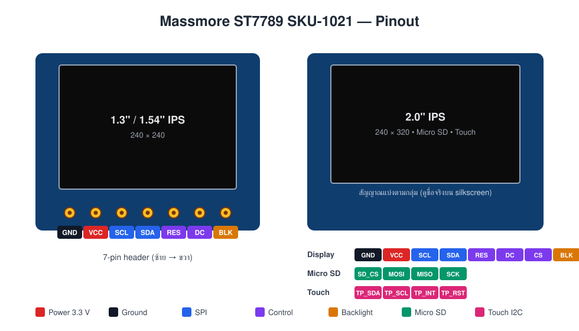
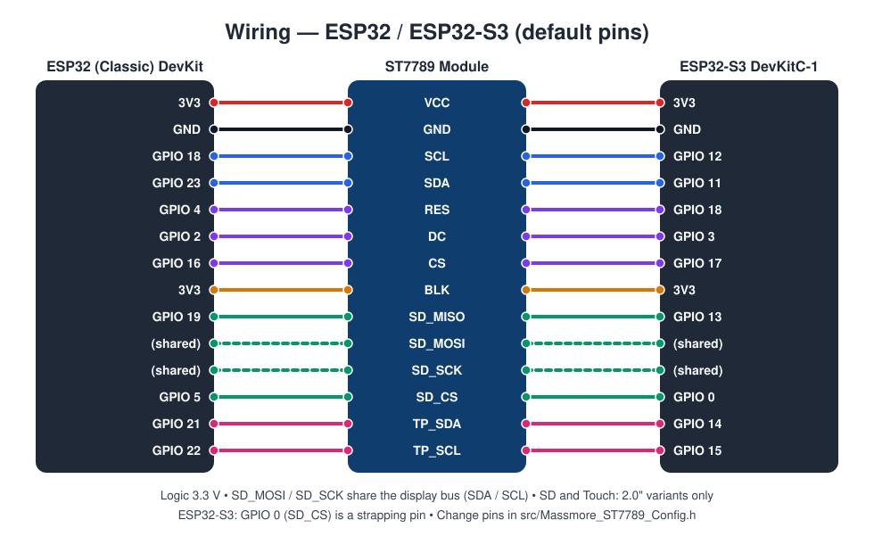

# Massmore_ST7789

**Massmore TFT LCD ST7789 SPI 1.3" / 1.54" / 2.0" IPS Display Module — Touch (CST816) + Micro SD (SKU-1021)**
Arduino IDE / PlatformIO driver library — *Designed and Manufactured by Massmore*

<!-- รูปสินค้า: วางไฟล์ docs/images/st7789-product-cover.jpg แล้วเอาคอมเมนต์บรรทัดล่างออก -->
<!-- <p align="center"></p> -->

> **เริ่มต้นเร็วที่สุด:** ต่อ SPI ตามตาราง §6 (3.3 V), เปิดตัวอย่าง `01_BasicDisplay` แล้ว upload — จอต้องแสดงแถบสี 8 สี
> อยากได้ภาษาไทย: `tft.loadFont(Massmore_Font_Kanit_28); tft.drawThaiString("สวัสดี", 10, 10);` (ฟอนต์ฝังมาแล้ว ไม่ต้องติดตั้งอะไรเพิ่ม)

---

## 1. Product Overview

โมดูลจอสี IPS TFT LCD ที่ใช้ driver **ST7789V** ต่อกับ MCU ผ่าน 4-wire SPI (SCL / SDA / DC / CS + RES)
รุ่น 2.0" มีช่อง Micro SD บนบอร์ด และรุ่น Touch มี capacitive touch controller **CST816** (I2C) เพิ่ม

**Massmore SKU-1021 variants**

| Variant | Resolution | Header | SD card | Touch |
|---|---|---|---|---|
| 1.3" IPS | 240 × 240 | 7-pin (GND VCC SCL SDA RES DC BLK) | — | — |
| 1.54" IPS | 240 × 240 | 7-pin | — | — |
| 2.0" IPS + SD | 240 × 320 | multi-pin | Micro SD (SPI, shared bus) | — |
| 2.0" IPS + SD + Touch | 240 × 320 | multi-pin | Micro SD | CST816 capacitive, I2C `0x15` |

**Key specs**

| Item | Spec |
|---|---|
| Display driver | Sitronix ST7789V (262K colour driver, ใช้งานที่ 65K / RGB565) |
| Panel | IPS, มุมมอง 170°, active area 1.3" = 23.4 × 23.4 mm, 1.54" = 27.72 × 27.72 mm |
| Interface | 4-wire SPI (SDA bidirectional), write clock ≤ 62.5 MHz, read clock ≤ 6.67 MHz (datasheet §7.4.3) |
| Logic level | **3.3 V** — ใช้กับ ESP32 / ESP32-S3 ได้ตรง; บอร์ด 5 V ต้องผ่าน level shifter |
| Power | 3.3 V (แนะนำ) หรือ 5 V สำหรับรุ่นที่มี on-board 3.3 V regulator |
| Backlight | ขา `BLK` — ต่อ 3V3 (เปิดตลอด) หรือต่อ GPIO เพื่อคุมความสว่างด้วย PWM |
| Touch (รุ่น Touch) | CST816, I2C address `0x15`, ขา INT / RST เป็น optional |

**Library highlights**

- ต่อยอดจาก **TFT_eSPI 2.5.43** (vendor ไว้ในไลบรารี — **ไม่ต้องติดตั้ง TFT_eSPI แยก ไม่ต้องแก้ User_Setup.h**) ใช้ API กราฟิกครบ: shapes, text, sprites, DMA, smooth fonts
- **ฟอนต์ไทย Kanit / Sarabun** ฝังมา 6 ขนาด + `drawThaiString()` จัดวรรณยุกต์ / สระบน / สระล่างอัตโนมัติ (ที่ นี้ น้ำ ปิ่น ญุ)
- **Chip identity & authenticity:** `verifyChipID()` (RDID1/2/3 = 0x85 0x85 0x52), `readStatus()`, `testFrameMemory()`, `isGenuine()`
- **Touch driver** `Massmore_ST7789_Touch` (CST816) — bus reference injection, ไม่ hardcode ขา, Simple + FSM API
- **Dual API:** Simple Blocking (`drawXxx`) และ Non-blocking DMA (`initDMA` / `pushImageDMA` / `dmaBusy`)
- Factory Test sketch + pre-compiled firmware สำหรับ Massmore Web Serial Monitor

---

## 2. Pinout

<p align="center"></p>

| Pin | Function | Notes |
|---|---|---|
| `GND` | Ground | |
| `VCC` | Power in | 3.3 V (แนะนำ) |
| `SCL` | SPI clock (SCLK) | 3.3 V logic |
| `SDA` | SPI data (MOSI) | **bidirectional** — ไลบรารีใช้อ่าน ID / status / GRAM กลับผ่านขานี้ (TFT_SDA_READ) |
| `RES` | Reset, active-low | ต้องต่อ (ไลบรารี pulse ให้ตอน `begin()`) |
| `DC` | Data / Command select | |
| `CS` | Chip select, active-low | |
| `BLK` | Backlight enable | ต่อ 3V3 = เปิดตลอด, หรือ GPIO + `-DTFT_BL=<gpio>` |
| `SD_CS`, `SD_MOSI`, `SD_MISO`, `SD_SCK` | Micro SD (รุ่น 2.0") | MOSI / SCK ต่อร่วมกับ `SDA` / `SCL` ของจอ, MISO ต่อ MISO ของ MCU |
| `TP_SDA`, `TP_SCL` (`TP_INT`, `TP_RST`) | CST816 touch (รุ่น Touch) | I2C 3.3 V, INT / RST ไม่ต่อก็ได้ |

<p align="center"></p>

---

## 3. MCU Compatibility & Limitation Matrix

| MCU Platform | Tested Core / Toolchain | Bus Remapping Support | Limitations / Notes |
|---|---|---|---|
| **ESP32-S3** | Arduino-ESP32 v3.x+ (pioarduino 55.03.311 / Core 3.3.11) | Full GPIO Matrix (ขาเปลี่ยนได้ทุกขา ผ่าน compile-time define) | None. SPI2 IOMUX pins 11/12/13 ได้ 80 MHz. |
| **ESP32 (Classic)** | Arduino-ESP32 v3.x+ (pioarduino 55.03.311 / Core 3.3.11) | Full GPIO Matrix (compile-time define) | None. **Primary Factory Test target.** VSPI IOMUX pins 18/19/23 ได้ 80 MHz. |
| **AVR — Arduino Nano (ATmega328P)** | — | — | **ไม่รองรับ** — 2 KB SRAM / 32 KB Flash ไม่พอสำหรับจอสี 240 × 320 + Thai smooth font และ TFT_eSPI ไม่รองรับ AVR; อีกทั้งโมดูลเป็น 3.3 V logic. ไลบรารีจะ `#error` ทันทีเมื่อ compile ด้วย AVR core |

Compile matrix: ทุกตัวอย่าง (01–07) × ทุก environment (`esp32dev`, `esp32-s3-devkitc-1`) build ผ่านด้วย `-Wall -Wextra` โดยไม่มี warning
คอร์อื่น (RP2040, STM32) TFT_eSPI รองรับ แต่ไลบรารีนี้ **ไม่ได้ตั้งค่าขาให้และไม่ได้ทดสอบ**

> **ข้อแตกต่างจากไลบรารี Massmore ตัวอื่น:** ST7789 ถูกขับด้วย TFT_eSPI ซึ่งใช้ขาแบบ *compile-time* (direct register write + DMA)
> จึงไม่รับขาผ่าน constructor แต่รวมไว้ที่ไฟล์เดียว `src/Massmore_ST7789_Config.h` และ override ได้ด้วย `-D` flag (ดู §6)

---

## 4. Installation

### Arduino IDE

1. ดาวน์โหลด [`ArduinoIDE/Massmore_ST7789.zip`](ArduinoIDE/Massmore_ST7789.zip)
2. **Sketch → Include Library → Add .ZIP Library…** เลือกไฟล์ ZIP
3. **File → Examples → Massmore_ST7789 → 01_BasicDisplay**
4. ติดตั้ง board package *esp32 by Espressif Systems* **v3.x ขึ้นไป** จาก Boards Manager แล้วเลือกบอร์ด ESP32 Dev Module / ESP32S3 Dev Module

ไม่ต้องติดตั้ง TFT_eSPI หรือฟอนต์เพิ่ม — ถ้าเคยติดตั้ง TFT_eSPI ไว้ก็ไม่ชนกัน (ไลบรารีนี้ include สำเนาของตัวเองจาก `src/vendor/`)

### PlatformIO (VS Code)

1. **File → Open Folder…** เปิดโฟลเดอร์ [`PlatformIO/`](PlatformIO/)
2. เลือก environment (`esp32dev` default หรือ `esp32-s3-devkitc-1`) แล้วกด **Build / Upload / Monitor**

ไลบรารี vendor ไว้ใน `PlatformIO/lib/Massmore_ST7789/` และ `platformio.ini` pin pioarduino ไว้ให้ได้ Arduino-ESP32 Core 3.x

---

## 5. Quick Start Code

```cpp
#include <Massmore_ST7789.h>
#include <Massmore_ST7789_Fonts.h>      // ฟอนต์ไทย Kanit / Sarabun (ใช้เท่าที่อ้างถึง)

Massmore_ST7789 tft;

void setup() {
  Serial.begin(115200);
  tft.begin(1);                                        // rotation 1 = landscape, ล้างจอเป็นดำ
  Serial.println(tft.verifyChipID() ? "ST7789V OK" : Massmore_ST7789::errorToString(tft.lastError()));

  tft.setTextColor(TFT_WHITE, TFT_BLACK);
  tft.drawString("Massmore ST7789", 10, 10, 4);        // built-in font 4

  tft.loadFont(Massmore_Font_Kanit_28);                // Thai smooth font
  tft.drawThaiString("สวัสดี ที่นี่ น้ำ ปิ่น", 10, 50);   // จัดวรรณยุกต์ให้ถูกต้องอัตโนมัติ
  tft.unloadFont();

  tft.fillCircle(60, 150, 30, TFT_RED);
}

void loop() { }
```

---

## 6. Pin Mapping

ค่า default ต่อ MCU (จาก [เอกสารสินค้า](https://www.massmore.shop/docs/32)) อยู่ใน `src/Massmore_ST7789_Config.h`:

| Module | ESP32 (Classic) | ESP32-S3 | Config macro |
|---|---|---|---|
| `SDA` (MOSI) | GPIO 23 | GPIO 11 | `TFT_MOSI` |
| `SCL` (SCLK) | GPIO 18 | GPIO 12 | `TFT_SCLK` |
| `SD_MISO` | GPIO 19 | GPIO 13 | `MASSMORE_ST7789_MISO` (-1 = ไม่ใช้ SD) |
| `CS` | GPIO 16 | GPIO 17 | `TFT_CS` |
| `DC` | GPIO 2 | GPIO 3 | `TFT_DC` |
| `RES` | GPIO 4 | GPIO 18 | `TFT_RST` |
| `BLK` | 3V3 | 3V3 | `TFT_BL` (ไม่กำหนด = ต่อ 3V3) |
| `SD_CS` (sketch) | GPIO 5 | GPIO 0 | กำหนดใน sketch |
| `TP_SDA` / `TP_SCL` (sketch) | GPIO 21 / 22 | GPIO 14 / 15 | กำหนดใน sketch (`Wire.begin(sda, scl)`) |

**ESP32 Core 3.x — ย้ายขา / เลือกรุ่นจอ (PlatformIO `platformio.ini`)**

```ini
[env:esp32dev]
extends = esp32_common
board = esp32dev
build_flags = ${env.build_flags}
  -DTFT_MOSI=13 -DTFT_SCLK=14 -DMASSMORE_ST7789_MISO=12 -DTFT_CS=15 -DTFT_DC=27 -DTFT_RST=26   ; ขาที่เลือกเอง
  -DTFT_BL=21                        ; ต่อ BLK กับ GPIO → setBrightness() ใช้ได้
  -DMASSMORE_ST7789_PANEL=240        ; จอ 1.3" / 1.54" (default 320 = 2.0")
  -DSPI_FREQUENCY=80000000           ; สายสั้นบน IOMUX pin
```

**ESP32-S3 — ค่า default ใช้ได้ทันที** (SPI2 IOMUX pins 11 / 12 / 13 → 80 MHz ได้)

```cpp
SPI.begin(TFT_SCLK, MASSMORE_ST7789_MISO, TFT_MOSI, -1);   // sketch เป็นเจ้าของ bus (จำเป็นเมื่อใช้ SD)
tft.begin(1);
```

**Arduino IDE** — แก้ค่า default ใน `Documents/Arduino/libraries/Massmore_ST7789/src/Massmore_ST7789_Config.h` (ทุกค่าอยู่ใน `#ifndef` พร้อมคำอธิบาย)

**สีเพี้ยน?** แดง ↔ น้ำเงินสลับ → `-DTFT_RGB_ORDER=TFT_RGB`; ภาพเป็นเนกาทีฟ → `-DMASSMORE_ST7789_NO_INVERSION`

---

## 7. API Reference

`Massmore_ST7789` สืบทอด `TFT_eSPI` — ใช้ทุกฟังก์ชันของ TFT_eSPI ได้ (`fillRect`, `drawString`, `pushImage`, `TFT_eSprite`, `loadFont` …) เพิ่มเติม:

| Function | Description | Return |
|---|---|---|
| `begin(rotation = 0, clearColor = TFT_BLACK)` | reset + init + rotation + ล้างจอ (start SPI ให้ถ้า sketch ยังไม่เรียก) | `bool` (true เสมอเมื่อ init เสร็จ; ผลอ่าน ID ดูที่ `lastError()`) |
| `lastError()` / `errorToString(e)` | `OK, NOT_FOUND, WRONG_ID, TIMEOUT, CRC_FAIL, BUS_ERROR, NOT_READY, NO_READ_SUPPORT` | `ErrorCode` / `const char*` |
| `verifyChipID()` | อ่าน RDID1/2/3 เทียบ 0x85 / 0x85 / 0x52 | `bool` |
| `readChipID()` | ID ดิบ 3 byte (`.raw()`, `.matches()`) | `ChipID` |
| `getSerialNumber()` | ST7789 ไม่มี serial register → 0 | `uint32_t` |
| `isGenuine()` | ID + RDDPM = 0x9C + self-diagnostic 0xC0 | `bool` |
| `readStatus()` | RDDPM, MADCTL, COLMOD, image / signal mode, self-diag | `Status` |
| `readRegister(cmd)`, `readDisplayStatus()` | อ่าน register 8-bit ใด ๆ / RDDST 32-bit | `uint8_t` / `uint32_t` |
| `testFrameMemory(n, failures)` | เขียน-อ่าน GRAM กลับ n จุด (คืนค่าเดิมให้) | `bool` |
| `hasReadSupport()` | build นี้อ่านจากจอได้หรือไม่ | `bool` (constexpr) |
| `sleep()` / `wake()` / `displayOn(bool)` | SLPIN / SLPOUT (รอ 120 ms ตาม datasheet) / DISPON-OFF | `void` |
| `setBacklight(bool)` / `setBrightness(0–255)` | ต้องกำหนด `TFT_BL`; PWM ใช้ Core 3.x `ledcAttach` | `bool` |
| `loadFont(Massmore_Font_Kanit_28)` | โหลด Thai smooth font (จาก TFT_eSPI) | `void` |
| `drawThaiString(utf8, x, y)` | วาดข้อความไทยพร้อมจัดวรรณยุกต์ (ใช้ `setTextDatum()` ได้) | `int16_t` width |
| `thaiTextWidth(utf8)` / `printThai(utf8)` | ความกว้างข้อความไทย / print ที่ cursor | `int16_t` / `size_t` |
| `shapeThai(in, out, size)` (static) | จัดรูปข้อความไทยเป็น code point สำรอง U+F700–F71A | `size_t` |
| `printConfig(Serial)` | พิมพ์ MCU / panel / pins / SPI clock ที่ compile มา | `void` |
| `initDMA()`, `pushImageDMA()`, `dmaBusy()`, `dmaWait()` | Non-blocking DMA (จาก TFT_eSPI) — ดูตัวอย่าง 03 | — |

`Massmore_ST7789_Touch` (ใน `Massmore_ST7789_Touch.h`):

| Function | Description | Return |
|---|---|---|
| `begin(Wire, intPin = -1, rstPin = -1, addr = 0x15)` | เริ่ม CST816 (sketch เรียก `Wire.begin(sda, scl)` ก่อน) | `bool` |
| `touched()` / `getRaw(x, y)` / `getTouch(x, y, rotation)` | Simple API — พิกัดดิบ / แปลงตาม rotation ของจอ | `bool` |
| `update()` / `isDataReady()` / `getReadings(Point&, rotation)` | Non-blocking FSM (ใช้ INT ถ้าต่อ, มิฉะนั้น poll ทุก 20 ms) | `bool` |
| `readChipID()` / `verifyChipID()` / `readFirmwareVersion()` / `readGesture()` | register 0xA7 / 0xA9 / 0x01 | `uint8_t` / `bool` |
| `setPanelSize(w, h)` / `setInvert(x, y)` / `setSwapXY(bool)` | ปรับทิศทางถ้าพิกัดกลับด้าน | `void` |

**Thai fonts (`Massmore_ST7789_Fonts.h`):** `Massmore_Font_Kanit_20 / 28 / 40`, `Massmore_Font_Sarabun_24 / 32 / 48` — ASCII + ไทยครบ + glyph จัดวรรณยุกต์
สร้างขนาด / น้ำหนักอื่นเองได้: `python3 extras/make_thai_font.py Kanit-Bold.ttf 36 Massmore_Font_KanitBold_36 out.h` (ต้องมี Pillow)

---

## 8. Examples

| # | Example | Description |
|---|---|---|
| 01 | `01_BasicDisplay` | init, อ่าน Chip ID, แถบสี, รูปทรง, ข้อความ, ตัวเลขนับวินาที (Simple API) |
| 02 | `02_CustomPins_BusRemap` | sketch เป็นเจ้าของ `SPI.begin()`, `printConfig()`, วิธี override ขา / รุ่นจอด้วย `-D` flag |
| 03 | `03_NonBlocking_Multitask` | Sprite + `pushImageDMA()` 60 fps + LED blink + loop counter — `loop()` ไม่ถูก block |
| 04 | `04_ThaiFont_Kanit_Sarabun` | ฟอนต์ไทย 6 ขนาด, การจัดวรรณยุกต์, จัดกึ่งกลาง / ชิดขวา, พื้นหลังทึบ, `printThai()` |
| 05 | `05_Touch_CST816` | (รุ่น Touch) วาดตามนิ้ว, พิกัด, FSM `update()` |
| 06 | `06_SDCard_SharedBus` | (รุ่น SD) จอ + SD บน SPI bus เดียวกัน: list / write / read (SD lib ของ ESP32 core) |
| 07 | `07_Factory_Test` | **Outgoing QA** — Chip ID, power mode, pixel format, self-diagnostic, GRAM readback, touch, SD, continuous → `#VERDICT` |

ทุกตัวอย่างไม่มี dependency ภายนอก (SD / Wire / SPI มากับ ESP32 core) และ build ผ่านทั้ง `esp32dev`, `esp32-s3-devkitc-1`

---

## 9. Factory Test & Web Serial Monitor

`07_Factory_Test` รันเองหลังบูตและพิมพ์ผลแบบ machine-parsable ที่ 115200:

```text
#MASSMORE_FACTORY_TEST v1.0
#PRODUCT Massmore_ST7789
#MCU ESP32
#RESULT DISPLAY_INIT PASS 320x240
#RESULT CHIP_ID PASS 0x858552
#RESULT POWER_MODE PASS 0x9C
#RESULT PIXEL_FORMAT PASS 0x55
#RESULT SELF_DIAG PASS 0xC0
#RESULT FRAME_MEMORY PASS 16/16
#RESULT AUTHENTICITY PASS GENUINE
#RESULT TOUCH_I2C PASS 0x15
#RESULT TOUCH_ID PASS 0xB6
#RESULT SD_MOUNT PASS 7580MB
#RESULT SD_RW PASS OK
#RESULT CONTINUOUS PASS 20/20
#VERDICT PASS
[PASS] SENSOR QA PASSED - READY TO SHIP
```

เฟิร์มแวร์สำเร็จรูป, วิธี flash (esptool / PlatformIO / web) และรายงานที่คาดหวังอยู่ที่ [`firmware/README.md`](firmware/README.md)

---

## 10. Troubleshooting

| อาการ | ตรวจ |
|---|---|
| จอขาว / ดำ ไม่แสดงอะไร | ไฟ 3.3 V + GND ร่วม, `RES` ต้องต่อ, ขา SCL/SDA/DC/CS ตรงกับ `printConfig()`, `BLK` ต่อ 3V3 |
| `CHIP_ID` อ่านได้ `0x000000` / `0xFFFFFF` | ขา SDA ไม่ตอบกลับ — ตรวจสาย SDA/CS; โมดูลที่มีขา SDO แยก ให้ `-DMASSMORE_ST7789_NO_SDA_READ -DTFT_MISO=<SDO pin>` |
| สีสลับ / เนกาทีฟ | `-DTFT_RGB_ORDER=TFT_RGB` / `-DMASSMORE_ST7789_NO_INVERSION` |
| ภาพเลื่อน / ขอบขาด บนจอ 1.3" / 1.54" | ต้อง `-DMASSMORE_ST7789_PANEL=240` |
| ภาพกระตุกที่ 80 MHz | ใช้ 40 MHz (default) หรือสายให้สั้นลง; ค่าอ่านใช้ 6 MHz ตาม datasheet อยู่แล้ว |
| `SD mount FAILED` | ฟอร์แมต FAT32, sketch ต้องเรียก `SPI.begin(sck, miso, mosi)` ก่อน `tft.begin()`, S3: GPIO0 เป็น strapping pin, ลอง 4 MHz |
| Touch ไม่ตอบ | SDA/SCL ของ touch แยกจาก SPI, `Wire.begin(sda, scl)` ก่อน `touch.begin()`, address 0x15 |
| จุดสัมผัสกลับด้าน / สลับแกน | `touch.setInvert(x, y)` / `touch.setSwapXY(true)` |
| ข้อความไทยเป็นสี่เหลี่ยม | ต้อง `loadFont(Massmore_Font_…)` ก่อน และใช้ `drawThaiString()` แทน `drawString()` |
| DMA + SD พร้อมกัน | อย่าใช้ `pushImageDMA()` ขณะ SD กำลังอ่านบน bus เดียวกัน (เรียก `dmaWait()` ก่อน) |

---

## 11. Where to Buy

- massmore.shop: <https://www.massmore.shop/products/5e1f85a3-6174-4861-aef3-dca6186013f2>
- บทความ / คู่มือสินค้า: <https://www.massmore.shop/docs/32>
- Shopee: <https://shopee.co.th/i.5641091.49704750884>
- Lazada: <https://www.lazada.co.th/products/pdp-i6042050290-s26180353038.html>

**References:** [ST7789VW Datasheet v1.0 (Sitronix)](https://www.buydisplay.com/download/ic/ST7789.pdf) · [TFT_eSPI by Bodmer](https://github.com/Bodmer/TFT_eSPI) · [Kanit](https://github.com/cadsondemak/kanit) / [Sarabun](https://github.com/cadsondemak/Sarabun) fonts (SIL OFL 1.1)

---

## 12. License

MIT License © 2026 Massmore Biz Co., Ltd. — see [`ArduinoIDE/Massmore_ST7789/LICENSE`](ArduinoIDE/Massmore_ST7789/LICENSE)
(รวมสัญญาอนุญาตของ TFT_eSPI, Adafruit GFX FreeFonts และฟอนต์ Kanit / Sarabun ที่ฝังมา)

Massmore · [www.massmore.shop](https://www.massmore.shop)
